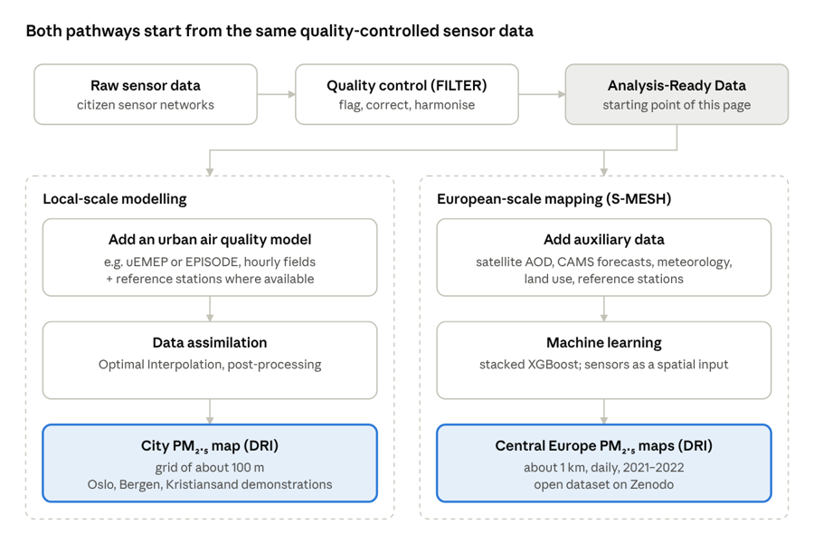
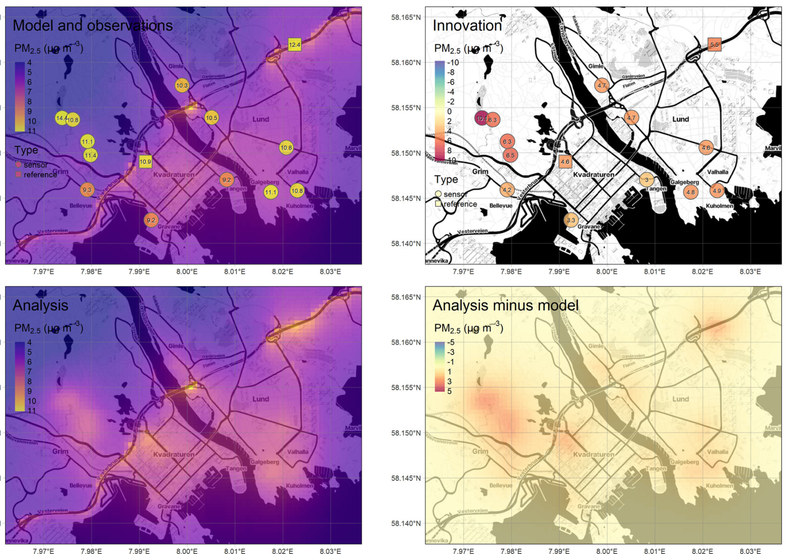
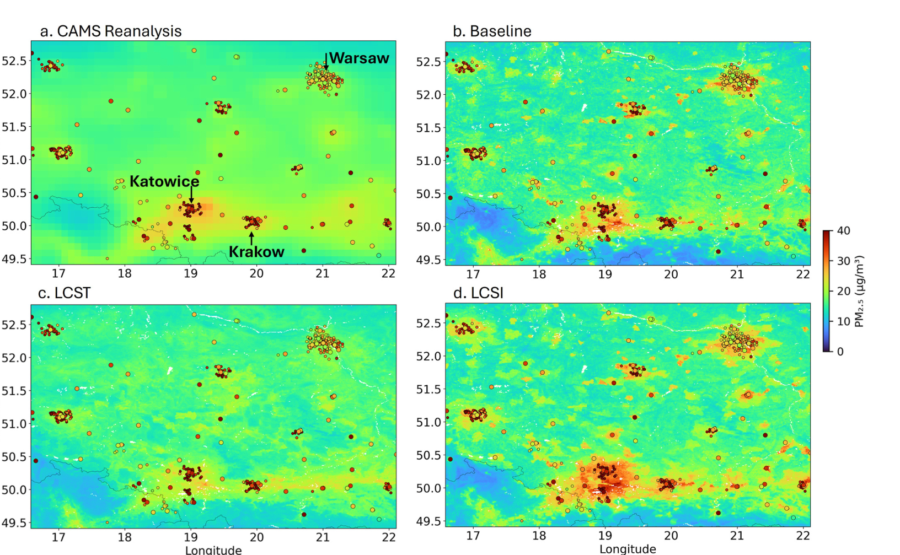

# How to generate Decision Ready Information based on Analysis Ready Data?

## Description

Low-cost sensor networks can deliver rich local measurements of air pollution. In the CitiObs toolkit, cleaned, validated and harmonised observations are referred to as **Analysis-Ready Data (ARD)**. The next step is to convert ARD into **Decision-Ready Information (DRI)**: maps and other information products that can support awareness, analysis and policy.

The toolkit presents two complementary pathways. At neighbourhood and city scale, ARD can be integrated into high-resolution urban air-quality models through **data assimilation**. At regional to continental scale, quality-controlled sensor observations can be incorporated into the **S-MESH machine-learning framework** to improve PM₂.₅ mapping. Figure 1 summarises the two approaches.

*Figure 1. The two CitiObs pathways for converting quality-controlled sensor data into mapped PM₂.₅ estimates. The LCS-enhanced S-MESH demonstration covers Central Europe, while the original S-MESH product covers a wider European domain.*

### Which approach should I use?

| | Local-scale modelling | European-scale mapping (S-MESH) |
|---|---|---|
| **Purpose** | Investigate air quality within a city or neighbourhood. | Explore daily PM₂.₅ patterns across larger regions. |
| **Coverage** | Individual cities (e.g. Oslo, Bergen, Kristiansand). | Europe (original S-MESH); Central Europe (CitiObs LCS-enhanced demonstration). |
| **Required inputs** | ARD, an urban air-quality model (e.g. uEMEP or EPISODE) and error information. | CAMS forecasts, satellite aerosol data, meteorology, reference stations and, for LCS-enhanced maps, ARD. |
| **Outputs** | City-scale concentration maps on a model grid of about 100 m. | Daily PM₂.₅ maps on a grid of about 1 km; downloadable 2021–2022 datasets. |
| **Expertise and access** | Air-quality modelling and data-assimilation expertise; case-study results. | Existing maps available for download; new applications require ML and geospatial expertise. |

## Why is this relevant?

Communities and city governments increasingly want to understand where and when pollution is high. Traditional monitoring stations are often too sparse to capture neighbourhood-scale variation. Citizen science networks can help fill these gaps, particularly when their observations are quality-controlled and combined with spatial modelling.

The resulting maps can support local assessments, citizen engagement and the investigation of **potential** pollution hotspots. However, a finer map grid does not necessarily mean equally fine-scale accuracy. Concentration patterns also **cannot, on their own, identify the emission sources** responsible for elevated pollution; that requires additional evidence or modelling.

## Methodological summary

### Local-Scale Approach: Data Assimilation

The local-scale methodology, described in [CitiObs Deliverable D2.3](https://citiobs.eu/wp-content/uploads/2026/03/CitiObs_D2.3-ValAir-MapAir-Toolkits_V1.pdf), merges LCS ARD with results from a high-resolution urban air-quality model such as uEMEP or EPISODE. The model provides a spatially continuous estimate, while sensor networks provide observations at specific locations. **Data assimilation** combines these sources while accounting for their uncertainties.

First, model predictions are compared with sensor observations. The **background-error covariance** determines how strongly and over what spatial extent these differences influence the map. The result is an updated concentration field (the *analysis*), reflecting both the model and the observations. Maps can have grid spacing of about **100 m**, but this should not be confused with demonstrated accuracy at that scale; the ability to represent local hotspots depends on model quality, sensor coverage and independent validation.

*Figure 2. PM₂.₅ in Kristiansand, Norway: model background and sensor observations, model–observation differences, assimilated analysis and resulting corrections (December 2020–February 2021). Cropped from [Bagkis et al. (2025), Fig. 3](https://doi.org/10.1038/s41612-025-01216-4), based on Hassani et al. (2023); CC BY 4.0. Basemap: OpenStreetMap contributors / Stamen Design (CC BY 3.0).*

### Regional / Continental Approach: S-MESH Machine Learning

For larger regions, CitiObs uses [S-MESH](https://models.nilu.no/models/s-mesh/), a machine-learning framework combining satellite aerosol information, meteorology, land-use characteristics, CAMS forecasts and reference-grade monitoring to estimate daily PM₂.₅. The **original S-MESH maps cover Europe**, while the CitiObs demonstration integrating LCS observations focused on **Central Europe** in 2021–2022.

Two strategies for incorporating quality-controlled LCS data were tested. Using LCS observations as training targets (LCST) performed less well than the reference-station baseline. A more successful approach (LCSI) used LCS measurements as additional spatial input features, while retaining reference stations as training targets. This improved mapping accuracy, especially where sensor coverage was good, although the benefits are less certain in sparsely monitored areas.

The result is a set of **daily PM₂.₅ maps on a ~1 km grid** that can help characterise regional pollution episodes and spatial patterns. As with local-scale modelling, grid spacing should not be interpreted as a guarantee of accuracy at that scale.

*Figure 3. Southern Poland, March 2021: CAMS reanalysis and S-MESH baseline, LCST and LCSI estimates. The comparison illustrates the effect of integrating LCS observations. From [Shetty et al. (2026), Fig. 8](https://doi.org/10.1016/j.envres.2025.123558); CC BY 4.0.*

## Accessing the results

Existing **daily GeoTIFF maps for 2021–2022** can be downloaded for [Europe (original S-MESH)](https://doi.org/10.5281/zenodo.13466510) and [Central Europe (CitiObs LCS-enhanced S-MESH)](https://doi.org/10.5281/zenodo.15704403). The Central European archive includes baseline, LCST and LCSI outputs for comparison. Quality-controlled sensor data and software resources are available through [ValAir/FILTER](https://github.com/CitiObs/ValAir).

The local-scale results are research demonstrations rather than a general public mapping service. Running either method for a new city or period requires suitable inputs and technical expertise. For collaboration or methodological questions, contact the [CitiObs team](https://citiobs.eu/) at **citiobs@nilu.no**.

## Useful resources

- [CitiObs Deliverable D2.3: ValAir and MapAir toolkits](https://citiobs.eu/wp-content/uploads/2026/03/CitiObs_D2.3-ValAir-MapAir-Toolkits_V1.pdf) — descriptions and local examples.
- [Shetty et al. (2025)](https://doi.org/10.1016/j.envres.2024.120363) — original S-MESH PM₂.₅ methodology.
- [Shetty et al. (2026)](https://doi.org/10.1016/j.envres.2025.123558) — integrating LCS observations into S-MESH.
- [Hassani et al. (2025)](https://doi.org/10.1016/j.jenvman.2025.125100) — FILTER quality control of LCS data.

## You might also be interested in

- [How to validate raw data](https://monitoring.toolkit.citiobs.eu/data-integration/how-validate-raw-data) — quality checks to apply to sensor data before generating ARD.
- [How to centralize access to ARD](https://monitoring.toolkit.citiobs.eu/data-integration/how-centralize-access-ard) — making analysis-ready data available from a single access point.
