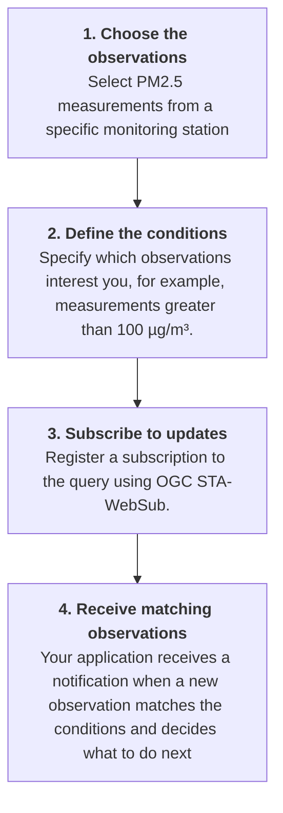

# How to add a real-time alerting system on the web? Using SensorThings API and WebSub

## Understanding real-time alerts

### What is a real-time alerting system?

Millions of sensors continuously collect data about our environment, measuring variables such as air quality, temperature, noise, water quality and many others. This information can be used to monitor environmental conditions, identify changes and support decision-making.

However, when building a monitoring system for a particular purpose, we usually do not need all the data from all the sensors. We need to identify what is significant for our purpose and receive timely updates about it.

A **real-time alerting system** allows an application to receive notifications when new data matches conditions that are relevant to its purpose, instead of having to repeatedly check whether something of interest has happened.

For example, imagine that you are building an air quality monitoring system. You want to receive a notification whenever a new observation reports a PM2.5 concentration above 100 µg/m³ at a particular monitoring station. You are not interested in every measurement from every station, but only in observations that match your specific conditions.

The system should allow you to specify what you are interested in and notify your application when a new observation meets those conditions.

### Why do we need individual, fit-for-purpose updates?

Environmental monitoring platforms may provide observations from thousands of sensors, operated by different organizations and using different technologies. A monitoring application may need data from several of these platforms, but only a small subset of the available observations may be relevant to its objectives.

For example, an application could be interested in:

- PM2.5 observations above a specified concentration.
- Temperature measurements from a particular geographical area.
- New observations collected during a specific period.
- Measurements of a particular property from selected monitoring stations.

The conditions can be combined to select the observations that are relevant to a particular monitoring purpose, as supported by the data service's query capabilities.

To achieve this across different platforms, we need **interoperability, flexible queries and a mechanism for delivering updates**. We need to be able to select the observations relevant to our monitoring purpose and receive notifications when new observations matching our criteria become available.

### How to receive the observations that matter to you

*Example: monitoring PM2.5 concentrations at a specific station.*



### How does it work?

The OGC SensorThings API (STA) provides a standardized way to access and query sensor observations. STAplus extends the SensorThings model for citizen science and related data-sharing scenarios.

The OGC SensorThings API WebSub extension (STA-WebSub) enables applications to subscribe to supported SensorThings API queries and receive asynchronous notifications when new observations matching those queries become available. STA-WebSub can be used with both STA and STAplus.

This allows applications to receive fit-for-purpose updates from different data providers without having to continuously request new data themselves.

The notification workflow involves three main components:

- **Publisher:** the data service that provides sensor observations and makes updates available.
- **Hub:** the component that manages subscriptions and distributes notifications to the applications that have subscribed.
- **Subscriber:** the application that registers a subscription and receives notifications through a web endpoint, commonly called a webhook.

The workflow has two distinct phases.

**Phase 1: Setting up a subscription**

The subscriber identifies a query describing the observations it wants to receive and registers a subscription with the hub. The subscription includes the information needed to identify the topic of interest and deliver notifications to the subscriber.

**Phase 2: Delivering notifications**

When a new observation becomes available and matches the subscribed query, the system can notify the subscriber through the hub. The receiving application can then process the notification.


*Figure 1. WebSub Flow Diagram show the flows between the subscriber, the publisher and the hub and how the subscription registration goes separately from the notification delivery.

The important point is that the subscription is established before the updates arrive. The application does not need to repeatedly ask whether new matching observations are available.

### What does a notification mean?

A notification is a message exchanged between software systems. Depending on the subscription and implementation, it may contain an observation or information about an update that allows the receiving application to retrieve or process the relevant data.

For example, an application might receive information about a new PM2.5 observation, including the monitoring station, measured value, unit and observation time.

The notification does not necessarily mean that an emergency has occurred. It means that an update matching the subscription is available.

The receiving application decides what to do next. It could:

- Update a map or dashboard.
- Store the observation for further analysis.
- Evaluate an additional condition.
- Display a warning in an application.
- Send an email, SMS or another message to a person.

```
STA-WebSub delivers notifications between software systems. It does not, by itself, send emails or SMS messages to end users. Those actions require an additional application or service.
```

### From observations to alerts: an example

Consider a monitoring application that tracks air quality at a particular station.

The application subscribes to a query for PM2.5 observations at that station with a result greater than 100 µg/m³.

Suppose the following observations become available:

| Observation | PM2.5 concentration | Matches the query? |
|---|---:|---|
| 10:00 | 35 µg/m³ | No |
| 10:05 | 82 µg/m³ | No |
| 10:10 | 112 µg/m³ | Yes |
| 10:15 | 95 µg/m³ | No |
| 10:20 | 125 µg/m³ | Yes |

The subscriber is interested in observations matching the query, rather than every observation from the station. The application can therefore focus on the observations at 10:10 and 10:20.

This example illustrates an important distinction: the subscription selects observations according to the query conditions. It does not necessarily detect the precise moment when a value crosses a threshold, calculate averages over a period or determine whether an environmental emergency exists. Such behaviour depends on the query, the data available and any additional processing performed by the receiving application.

The same principle applies to other variables and conditions, provided they can be expressed using the supported SensorThings API query capabilities.

**You don't need all the data. You need the data that matters to you.**


## Try the demonstration

This section introduces the STA-WebSub workflow through a practical demonstration. The aim is to understand how to discover a query, subscribe to updates and receive notifications, without having to deploy your own system.

The demonstration uses hosted services. This is different from deploying a complete STA-WebSub system, which requires configuring the data service, hub and subscriber application.

### What do you need?

Before starting, make sure that you have access to the following resources:

- **A SensorThings API service:** a service providing sensor observations that you can explore and query.
- **A STA-WebSub discovery service:** a service that helps identify which queries can be subscribed to.
- **A STA-WebSub hub:** a service that manages subscriptions and distributes notifications.
- **A subscriber endpoint:** an application or webhook capable of receiving notifications.

Use the demonstration services linked below. If a service requires authentication or a specific configuration, follow the instructions provided for that service.

[Insert the verified links to the hosted SensorThings API, discovery service, hub and subscriber demonstration.]

### Step 1 — Explore the sensor data

Start by opening the SensorThings API service used by the demonstration.

Explore the available observations and identify a variable that interests you. For example, you could select PM2.5 measurements from a particular monitoring station.

SensorThings API organizes information about sensors, observed properties, datastreams and observations. These resources can be queried to identify the data relevant to your monitoring objective.

At this stage, the goal is simply to understand what data is available and which observations you want to monitor.

[Insert screenshot: the SensorThings API service showing an example of the available data.]

### Step 2 — Define the observations you want to receive

Next, define a query that describes the observations relevant to your purpose.

For example, suppose you want to receive PM2.5 observations from a particular station only when the measured concentration is greater than 100 µg/m³.

The query can specify conditions supported by the SensorThings API, such as:

- The observed property or datastream.
- The monitoring station or geographical location.
- The observation time or time interval.
- The measured result.
- Other supported query conditions.

These criteria determine which observations are relevant to the subscription.

[Insert screenshot: the example query, including the selected station and result condition.]

### Step 3 — Discover the subscription topic

Once you have defined the query, use the STA-WebSub discovery mechanism to determine whether the query can be subscribed to.

Discovery helps the subscriber identify the information needed to establish a subscription with the hub. The exact requests and responses depend on the implementation and are explained in the technical section of this guide.

At this stage, you are checking that the query can be used for notifications, rather than creating the subscription itself.

[Insert screenshot: the discovery service and the information returned for the selected query.]

### Step 4 — Register the subscription

Register a subscription with the STA-WebSub hub using the information obtained during discovery.

The subscription identifies the topic of interest and specifies where notifications should be delivered. The destination is a subscriber endpoint capable of receiving the notifications.

Once the subscription has been successfully established, the hub can use it to deliver relevant updates when they become available.

[Insert screenshot: the subscription request or the interface used to register the subscription.]

### Step 5 — Receive and inspect a notification

When a new observation matching the subscribed query becomes available, the subscriber can receive a notification through its registered endpoint.

Inspect the notification and compare it with the corresponding observation in the SensorThings API service.

Check the information available in the message, such as the observation identifier, measured value, unit and observation time, where these fields are provided.

This step demonstrates the difference between registering a subscription and receiving a notification: a successful subscription establishes the mechanism for future updates, but it does not necessarily produce an immediate notification.

If the selected data service does not generate new matching observations during the demonstration, you may need to wait for an update or use a documented test mechanism, if one is available.

[Insert screenshot: an actual notification received by the subscriber, with the relevant fields highlighted.]

### What have you learned?

By completing the demonstration, you should understand how to:

- Identify the observations relevant to a monitoring purpose.
- Define a query that selects those observations.
- Discover whether the query supports a subscription.
- Register the subscription with a STA-WebSub hub.
- Receive and inspect notifications when matching updates become available.

The demonstration illustrates how STA-WebSub enables applications to receive updates without repeatedly polling the data service.

### What if you want to deploy your own system?

The hosted demonstration is intended to help you understand the workflow. To deploy your own system, you need to configure the components required by your use case.

These generally include a SensorThings API service, a compatible STA-WebSub discovery mechanism, a hub and a subscriber application with an endpoint accessible to the hub.

You will also need to consider authentication and access control, secure communication, subscription management and the handling of notifications.

The following sections explain the technical architecture, the discovery process, subscription registration, notification delivery and the available implementations and resources.

Proceed to the technical section to learn how to configure and integrate these components.

## How does STA-WebSub work?

Data readings form different sensors can be made available using the [OGC Sensor Things API](https://docs.ogc.org/is/18-088/18-088.html) also known as STA. The API can be separated in a MQTT and a HTTP interface. The HTTP interface is typically used for reading observations (data readings provided by the connected sensors) or creating entities like Datastream, Things, etc. that are required for sensors to publish observations. The MQTT interface is typically used by low cost sensors to publish their data readings.

When it comes to establishing a real-time (or near real time) alerting system, it is necessary that an interested client can receive alerts at the time they take place. This requires some kind of a subscription mechanism that allows the client to register for events. The STA MQTT interface can be used to subscribe for events but it requires that the MQTT port(s) can make it through all intermediate firewalls. Alos, it is required that the underlying TCP socket remains connected at all time. Otherwise, the client and server need to implement error handling properly which is very complicated. So, even though the MQTT interace could be used to build an alerting system for IoT devices, there are performance and security arguments that indicate not to use the MQTT build into a STA deployment: Using the same MQTT broker for sensors to publish data and to deliver events to all subscribed clients is difficult to scale as the load heavily depend on the number of subscribers and the events they subscribe to. For scaling an MQTT broker without controlling the subscriptions is difficult as there could be subscribers to very chatty events like `v1.1/Observations`. Establishing re-scaling of the MQTT broker is almost impossible and introducing access control requires a proprietary layer to be implemented. These challenges in summary indicate to leverage the STA MQTT interface for registered sensors to publish their readings. But how to establish the alerting-system to support the scaling notifications of events?

The [W3C WebSub](https://www.w3.org/TR/websub/) defines a protocol to build an alerting system over the Web. In a nutshell, WebSub defines three roles: A subscriber is the entity that is first discovering topics (events) at a publisher that can be used for subscription. Once the subscriber found a topic, a subscription for hte topic is made to the associated hub. In the context of SensorThings API, the discovery of self-defined topics provides the flexibility for any client to shape the event trigger and data structure using a regular STA query.

In order to build an alerting system for sensors over the Web based on STA, a combination with the W3C WebSub seems to be the approach. The [OGC SensorThings API Extension: WebSub Asynchronous Messaging Standard] https://docs.ogc.org/is/24-032r1/24-032r1.html)(STA-WebSub) is currently a OGC standard. The STA-WebSub standard defines the required changes to adopt the W3C WebSub protocol with SensorThings API v1.1.

### Why is STA-WebSub relevant?

The use of STA-WebSub enables the building of a (near) real-time alerting system over the Web by combingin the W3C WebSub and the OGCSensorThings API v1.1. The basic use is that a client can use a regular HTTP URL to fetch data but also to discover whether that URL could be used for subscription. This is a powerful mechanism, as the subscriber (client) can self-define (i) the condition for a notification event and (ii) the data structure being returned when the event occurs. The prevent that large amounts of data is returned with the discovery, HTTP HEAD requests can be used. Once the client has confidence to have found a topic, the client can use the HTTP GET request to fetch the base data and then subscribe with the exact same URL to the associated hub to receive the alerts when the event occurs. Because the data shaping query part of the URL has not changed, the data structure for the alerts remain identical with the base data which eases the processing of the alerts.

As outlined in the W3C WebSub, each subscription has a receiving Webhook URL hosted at the subscriber. The use of Webhooks do not require TCP sockets to remain open. Each time that a subscription event occurs, the hub uses the associated Webhook (callback URL) to deliver the alert data. Dedicated processing at the subscriber's side is straight forward for each Webhook: First, the subscriber should check via the X-Hub-Signature mechanism that the received alert data (i) was sent by the expected hub and (ii) has not been tampered.

There are three major improvements by leveraging STA-WebSub over the STA MQTT. The first improvement is concerned with event (alert) distribution: The STA-WebSub does use regular HTTP(S) firewall ports and the requirement to keep a MQTT socket continously open does not exist. The STA MQTT broker delivers the events to the hub which is supposed to be deployed in a network close to the STA service. This means that external subscriptions (other than coming from the hub) can be denied by the broker. The second improvement is concerned with the security and the performance of the MQTT broker. The topic discovery, done by subscribers via the STA HTTP interface can include access control. The access control policy can control which subscribers can subscribe to which topic and what hub to use. So, for example, a STA service could be associated with three different hubs: (i) The first hub could be optimized for chatty topics with short alert data like `v1.1/Observations`; (ii) the second hub could be optimized for large alert data; and (iii) the third hub could be exclusive for paying subscribers ensuring a "exact-once" delivery of alerts. The third improvement is concerned with the ease to scale hubs. During the topic discovery, a STA service returns theURL for the hub that the subscriber should use for subscription. Enforcing "short" subscription expiration ensures that scaling up/down can take place without impacting the MQTT broker.

### Useful resources

Based on OGC STA-WebSub, a complete alerting system over the Web for IoT sensors was implemented as open source:

* [FROST-Server](https://github.com/FraunhoferIOSB/FROST-Server) is the open source reference implementation for OGC SensorThings API v1.1 by Fraunhofer
* [FROST-Server-WebSub](https://github.com/securedimensions/FROST-Server-WebSub) is the open source implementation of a FROST-Server plugin that enables STA-WebSub
* [STA-WebSub-Hub](https://github.com/securedimensions/STA-WebSub-Hub) is an open source implementation of a STA-WebSub Hub that demonstrates the W3C WebSub subscription protocol and the subscription/notification with a STA service (FROST-Server)
* [STA-WebSub-Discovery](https://github.com/CitiObs/environmental-monitoring-toolkit/blob/main/docs/data-integration/\[https:/github.com/securedimensions/STA-WebSub-Subscriber]\(https:/github.com/securedimensions/STA-WebSub-Discovery\)/README.md) is an open source implementation to demonstrate the use of STA-Websub for discovering topics (executed by subscribers)
* [STA-WebSub Subscriber](https://github.com/grumets/ganxet) is an example implementation of a STA-WebSub Subscriber
* [TAPIS](how-to-add-a-real-time-alerting-system-on-the-web.md) is an example implementation of a Web-Application to visualize alerts received via a STA-WebSub Hub

Online resources demonstrating the use of STA-WebSub:

* [STA-WebSub Discovery client](https://sta-websub-discovery.citiobs.secd.eu/) is a Web-Application that demonstrates the STA-WebSub discovery with a STA service
* [STA service (STA-WebSub enabled)](https://citiobs.demo.secure-dimensions.de/staplustest/v1.1) is a STA service endpoint that is assoviated with a STA-WebSub Hub
* [STA-WebSub Hub](https://sta-websub-hub.citiobs.secd.eu/) is a Web-Application that connects to a STA-WebSub Hub which is connected to the STA service above
* [TAPIS](https://www.tapis.grumets.cat/) is a Web-Application that illustrates the use of the demo alerting system

### You might be also interested in...

The deployment and use of the CitiObs (near) real-time alerting system for IoT sensors on the Web based on STA-WebSub was illustrated during the OGC Code Sprint in Rotterdam from 20 - 22 October 2025. More details are available from the [Code Sprint Wiki](https://github.com/opengeospatial/developer-events/wiki/October-2025-Open-Standards-Code-Sprint#introduction-to-sta-websub) and [here](https://github.com/opengeospatial/developer-events/wiki/Introduction-to-STA%E2%80%90WebSub).
