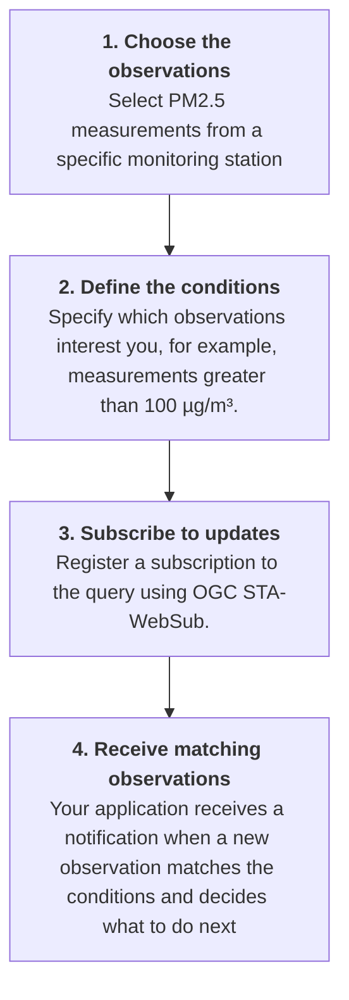
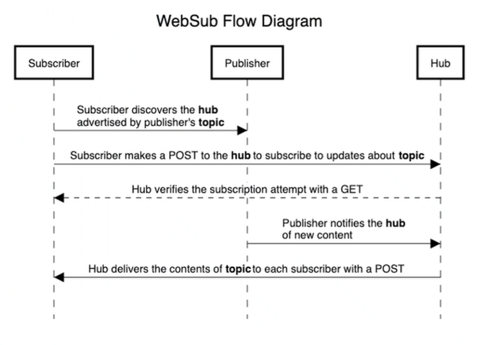
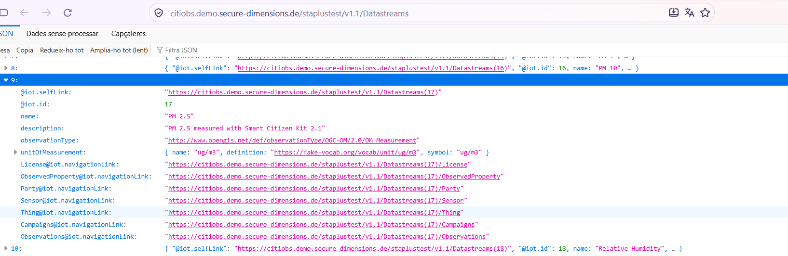
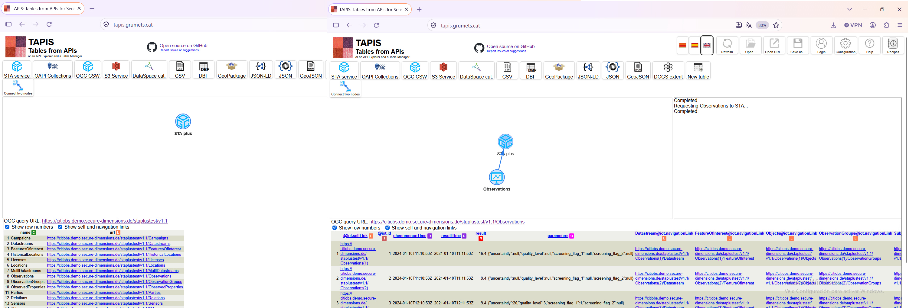
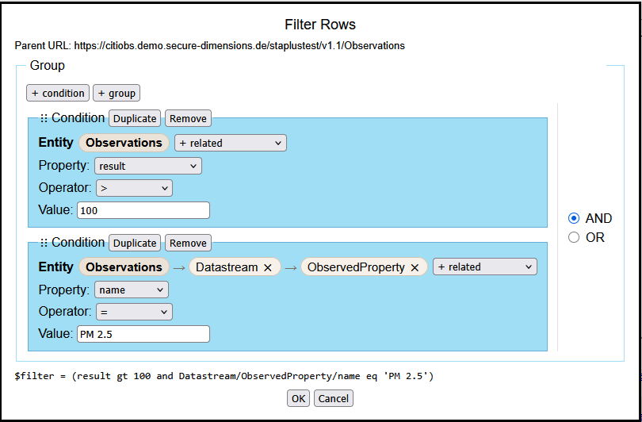
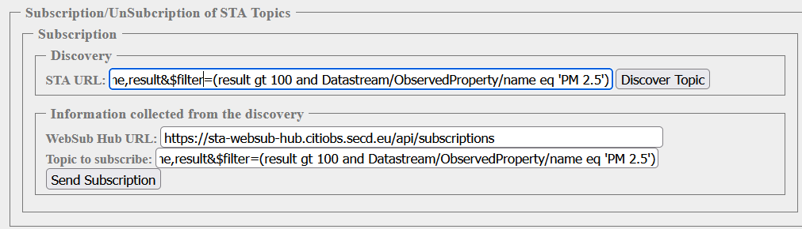
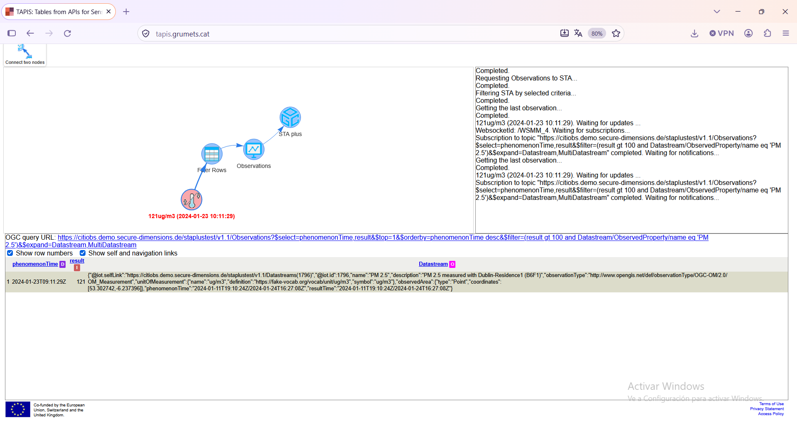

# How to add a real-time alerting system on the web using SensorThings API and WebSub

## Understanding real-time alerts

### What is a real-time alerting system?

Millions of sensors continuously collect data about our environment, measuring variables such as air quality, temperature, noise, water quality and many others. This information can be used to monitor environmental conditions, identify changes and support decision-making.

However, when building a monitoring system for a particular purpose, we usually do not need all the data from all the sensors. We need to identify what is significant for our purpose and receive timely updates about it.

A **real-time alerting system** allows an application to receive notifications when new data matches conditions that are relevant to its purpose, instead of having to repeatedly check whether something of interest has happened.

For example, imagine that you are building an air quality monitoring system. You want to receive a notification whenever a new observation reports a PM2.5 concentration above 100 µg/m³ at a particular monitoring station. You are not interested in every measurement from every station, but only in observations that match your conditions.

The system should allow you to specify what you are interested in and notify your application when a new observation meets those conditions.

### Why do we need individual, fit-for-purpose updates?

Environmental monitoring platforms may provide observations from thousands of sensors, operated by different organizations and using different technologies. A monitoring application may need data from several of these platforms, but only a small subset of the available observations may be relevant to its objectives.

For example, an application could be interested in:

- PM2.5 observations above a specified concentration.
- Temperature measurements from a particular geographical area.
- New observations collected during a specific period.
- Measurements of a particular property from selected monitoring stations.

The conditions can be combined to select the observations relevant to a particular monitoring purpose, as supported by the data service's query capabilities.

To achieve this across different platforms, we need **interoperability, flexible queries and a mechanism for delivering updates**. We need to select the observations relevant to our monitoring purpose and receive notifications when new observations matching our criteria become available.

### How to receive the observations that matter to you

*Example: monitoring PM2.5 concentrations at a specific station.*



### How does it work?

The **OGC SensorThings API (STA)** provides a standardized way to access and query sensor observations. **OGC STAplus** extends the SensorThings model for citizen science and related data-sharing scenarios.

The **OGC SensorThings API Extension: WebSub Asynchronous Messaging Standard (STA-WebSub)** enables applications to subscribe to supported SensorThings API queries and receive asynchronous notifications when new observations matching those queries become available. STA-WebSub can be used with both STA and STAplus.

The notification workflow involves three main components:

- **Publisher:** the data service that provides sensor observations and makes updates available.
- **Hub:** the component that manages subscriptions and distributes notifications to subscribers.
- **Subscriber:** the application that registers a subscription and receives notifications through a web endpoint, commonly called a *webhook*.

The workflow has two phases:

1. **Setting up a subscription:** The subscriber identifies a query describing the observations it wants to receive and registers a subscription with the hub. The subscription includes the information needed to identify the topic of interest and deliver notifications to the subscriber.

2. **Delivering notifications:** When a new observation becomes available and matches the subscribed query, the system can notify the subscriber through the hub. The receiving application can then process the notification.




*Figure 1. WebSub flow diagram showing the publisher, hub and subscriber, with separate flows for subscription registration and notification delivery.*

The important point is that the subscription is established before updates arrive. The application does not need to repeatedly ask whether new matching observations are available.

### What does a notification mean?

A notification is a message exchanged between software systems. Depending on the subscription and implementation, it may contain an observation or information about an update that allows the receiving application to retrieve or process the relevant data.

For example, an application might receive information about a new PM2.5 observation, including the monitoring station, measured value, unit and observation time.

The notification does not necessarily mean that an emergency has occurred. It means that an update matching the subscription is available. The receiving application decides what to do next. It could:

- Update a map or dashboard.
- Store the observation for further analysis.
- Evaluate an additional condition.
- Display a warning in an application.
- Send an email, SMS or another message to a person.

```
STA-WebSub delivers notifications between software systems. 
It does not, by itself, send emails or SMS messages to end users. 
Those actions require an additional application or service.
```

### From observations to alerts: an example

Consider a monitoring application that tracks air quality at a particular station. The application subscribes to a query for PM2.5 observations at that station with a result greater than 100 µg/m³.

Suppose the following observations become available:

| Observation time | PM2.5 concentration | Matches the query? |
|---|---:|---|
| 10:00 | 35 µg/m³ | No |
| 10:05 | 82 µg/m³ | No |
| 10:10 | 112 µg/m³ | Yes |
| 10:15 | 95 µg/m³ | No |
| 10:20 | 125 µg/m³ | Yes |

The subscriber is interested in observations matching the query, rather than every observation from the station. The application can therefore focus on the observations at 10:10 and 10:20.

This example illustrates an important distinction: the subscription selects observations according to the query conditions. It does not necessarily detect the precise moment when a value crosses a threshold, calculate averages over a period or determine whether an environmental emergency exists. Such behaviour depends on the query, the data available and any additional processing performed by the receiving application.

The same principle applies to other variables and conditions, provided they can be expressed using the supported SensorThings API query capabilities.

**You don't need all the data. You need the data that matters to you.**


## Try the demonstration

This section introduces the STA-WebSub workflow through a practical demonstration. The aim is to understand how to discover a query, subscribe to updates and receive notifications, without having to deploy your own system.

The demonstration uses hosted services. This is different from deploying a complete STA-WebSub system, which requires configuring the data service, hub and subscriber application.

### What do you need?

Before starting, make sure that you have access to the following resources:

- **A SensorThings API service:** a service providing sensor observations that you can explore and query.
- **A STA-WebSub discovery service:** a service that helps identify which queries can be subscribed to.
- **A STA-WebSub hub:** a service that manages subscriptions and distributes notifications.
- **A subscriber endpoint:** an application or webhook capable of receiving notifications.

The hosted demonstration services are listed in [Hosted demonstration services](#hosted-demonstration-services). If a service requires authentication or specific configuration, follow the instructions provided for that service.

### Step 1 — Explore the sensor data

Open the SensorThings API service used by the demonstration.

Explore the available observations and identify a variable that interests you. For example, you could select PM2.5 measurements from a particular monitoring station.

SensorThings API organizes information about sensors, observed properties, datastreams and observations. These resources can be queried to identify the data relevant to your monitoring objective.

At this stage, the goal is to understand what data is available and which observations you want to monitor.



*Figure: Exploring the STAplus service. The `Datastreams` collection lists the available data streams, including the `PM 2.5` datastream (ID 17) shown in the screenshot.*



*Figure: Exploring the STAplus service using the TAPIS tool.*

The service endpoint used in this example is the [STAplus SensorThings API service](https://citiobs.demo.secure-dimensions.de/staplustest/v1.1).

### Step 2 — Define the observations you want to receive

Define a query that describes the observations relevant to your purpose.

For this example, we will subscribe to observations whose observed property is `PM 2.5` and whose result is greater than 100 µg/m³.



*Figure: Filtering observations using the TAPIS tool.*

The topic URL is a regular SensorThings API query:

```text
https://citiobs.demo.secure-dimensions.de/staplustest/v1.1/Observations?$filter=Datastream/ObservedProperty/name eq 'PM 2.5' and result gt 100
```

This query selects observations from any datastream whose observed property is named `PM 2.5`, provided that `result` is greater than 100. To monitor one station only, add an additional filter for the relevant `Thing` or `Datastream`.

The query can specify conditions supported by the SensorThings API, such as:

- The observed property or datastream.
- The monitoring station or geographical location.
- The observation time or time interval.
- The measured result.
- Other supported query conditions.

These criteria determine which observations are relevant to the subscription.

### Step 3 — Discover the subscription topic

Use the STA-WebSub discovery mechanism to determine whether the query can be subscribed to.

Discovery helps the subscriber identify the information needed to establish a subscription with the hub. The exact requests and responses depend on the implementation and are explained in the technical section of this guide.

At this stage, you are checking that the query can be used for notifications, rather than creating the subscription itself.



*Figure: Discovering a topic with a simple subscriber client. The client sends an HTTP HEAD request to the STA service for the topic it wants to subscribe to. The STA service responds with links that identify the subscription endpoint and the topic.*


### Step 4 — Register the subscription

Register a subscription with the STA-WebSub Hub using the information obtained during discovery.

The subscription identifies the topic of interest and specifies where notifications should be delivered. The destination is a subscriber endpoint capable of receiving the notifications.

Once the subscription has been successfully established, the hub can use it to deliver relevant updates when they become available.

### Step 5 — Receive and inspect a notification

When a new observation matching the subscribed query becomes available, the subscriber can receive a notification through its registered endpoint.

Inspect the notification and compare it with the corresponding observation in the SensorThings API service. Check the information available in the message, such as the observation identifier, measured value, unit and observation time, where these fields are provided.

You can also open the topic query directly to inspect observations that match the filter. For example, a matching observation could have the following structure:

```json
{
  "@iot.selfLink": "https://citiobs.demo.secure-dimensions.de/staplustest/v1.1/Observations(323303)",
  "@iot.id": 323303,
  "phenomenonTime": "2024-01-23T09:11:29Z",
  "resultTime": "2024-01-23T09:11:29Z",
  "result": 121.0,
  "Datastream@iot.navigationLink": "https://citiobs.demo.secure-dimensions.de/staplustest/v1.1/Observations(323303)/Datastream",
  "FeatureOfInterest@iot.navigationLink": "https://citiobs.demo.secure-dimensions.de/staplustest/v1.1/Observations(323303)/FeatureOfInterest"
}
```

A successful subscription establishes the mechanism for future updates, but it does not necessarily produce an immediate notification. If the selected data service does not generate new matching observations during the demonstration, you may need to wait for an update or use a documented test mechanism, if one is available.



*Figure: Retrieving PM2.5 observations above 100 µg/m³ and subscribing to notifications for new observations matching this topic.*

### What have you learned?

By completing the demonstration, you should understand how to:

- Identify the observations relevant to a monitoring purpose.
- Define a query that selects those observations.
- Discover whether the query supports a subscription.
- Register the subscription with a STA-WebSub hub.
- Receive and inspect notifications when matching updates become available.

The demonstration illustrates how STA-WebSub enables applications to receive updates without repeatedly polling the data service.

### What if you want to deploy your own system?

The hosted demonstration is intended to help you understand the workflow. To deploy your own system, you need to configure the components required by your application. These generally include a SensorThings API service, a compatible STA-WebSub discovery mechanism, a hub and a subscriber application with an endpoint accessible to the hub.

You will also need to consider authentication and access control, secure communication, subscription management and notification handling. The next section describes the technical architecture and the main implementation considerations.

## Technical implementation: How does STA-WebSub work?

This section explains how STA-WebSub works with SensorThings API, why it can be useful for distributing notifications, and the main steps involved in discovery, subscription and delivery.

### SensorThings API and its interfaces

Data from different sensors can be made available through the [OGC SensorThings API](https://docs.ogc.org/is/18-088/18-088.html), also known as STA.

STA provides an HTTP interface and an MQTT interface. The **HTTP interface** is commonly used to retrieve observations and to create or manage entities such as `Datastreams` and `Things`. The **MQTT interface** can be used by connected sensors to publish their readings. MQTT also supports event subscriptions, but using it as the external notification mechanism for a large and diverse set of subscribers raises operational considerations.

### Why combine SensorThings API with WebSub?

To build a real-time (or near-real-time) alerting system, an interested client needs a way to receive notifications when relevant events occur. This requires a subscription mechanism that allows the client to register its interest in particular events.

The STA MQTT interface can be used to subscribe to events, but MQTT traffic must be able to pass through any intervening firewalls, and the underlying TCP socket connection generally needs to remain open. If the connection is interrupted, the client and server must handle reconnection and error recovery, which can add complexity.

Although MQTT can be used to build alerting systems for IoT devices, there are performance and security considerations when using the MQTT broker built into an STA deployment as the external notification mechanism. Using the same MQTT broker for sensors to publish data and to deliver events to all subscribed clients can be difficult to scale, because the load heavily depends on the number of subscribers and the events to which they subscribe. For scaling an MQTT broker without controlling the subscriptions is difficult as there could be subscribers to very chatty events like `v1.1/Observations`. Establishing re-scaling of the MQTT broker is almost impossible and introducing access control requires a proprietary layer to be implemented. These challenges in summary indicate to leverage the STA MQTT interface for registered sensors to publish their readings. But how to establish the alerting-system to support the scaling notifications of events?

The [W3C WebSub](https://www.w3.org/TR/websub/) standard defines a protocol for subscribing to topics on the Web and distributing updates asynchronously. It defines three main roles:

- **Publisher:** makes topics available for discovery and publishes updates.
- **Hub:** handles subscription requests and distributes updates to subscribers.
- **Subscriber:** discovers a topic at a publisher that can be used for subscription, subscribes to it through the associated hub and receives updates.

In the context of OGC SensorThings API, the discovery of self-defined topics provides the flexibility for any client to shape the event trigger and data structure using a regular STA query.

STA-WebSub adapts the WebSub protocol to SensorThings API v1.1. It allows a client to use a SensorThings API query to define both the observations of interest and the data returned when a matching update occurs.

The official standard is the [OGC SensorThings API Extension: WebSub Asynchronous Messaging Standard](https://docs.ogc.org/is/24-032r1/24-032r1.html) (STA-WebSub).

### Why is STA-WebSub relevant?

STA-WebSub makes it possible to build a real-time or near-real-time alerting system on the Web by combining W3C WebSub with OGC SensorThings API v1.1. A client can use a regular HTTP URL both to retrieve data and to discover whether the URL can be used as a subscription topic.

This is a powerful mechanism, as the subscriber (client) can self-define (i) the condition for a notification event and (ii) the data structure being returned when the event occurs. To avoid returning large amounts of data during discovery, the client can use an HTTP `HEAD` request. Once the client has confirmed that a URL is available as a topic, the client can use an HTTP GET request to retrieve the matching data and then subscribe to the associated hub using the same URL to receive the alerts when the event occurs. Because the query that shapes the data remains unchanged, the notification data can have the same structure as the data returned by the original query, making notifications easier to process.

As described by W3C WebSub, each subscription specifies a receiving Webhook URL hosted by the subscriber. Webhooks do not require a TCP socket to remain open. Each time that a subscription event occurs, the hub uses the associated Webhook (callback URL) to deliver the alert data. Dedicated processing at the subscriber's side is straight forward for each Webhook: the subscriber should validate the `X-Hub-Signature` header to check that the notification or received alert data (i) was sent by the expected hub and (ii) has not been tampered with.

STA-WebSub offers several potential advantages over exposing the STA MQTT broker directly to external subscribers. First improvement is concerned with event (alert) distribution: The STA-WebSub does use regular HTTP(S) firewall ports and the requirement to keep a MQTT socket continuously open does not exist. The STA MQTT broker can deliver events to a hub which is supposed to be deployed in a network close to the STA service, while direct external subscriptions to the broker can be denied.

The second improvement is concerned with the security and the performance of the MQTT broker. Topic discovery through the STA HTTP interface can apply access-control policies. This policies can determine or control which subscribers may subscribe to which topics and which hub they should use. For example, an STA service could be associated with different hubs optimized for high-volume topics with small notification payloads (such as `v1.1/Observations`), larger payloads, or a specific class of subscribers. Any guarantee such as exactly-once delivery depends on the capabilities and configuration of the implementation and should not be assumed automatically.

Third, separating hubs from the MQTT broker can make it easier to scale notification delivery. During topic discovery, the STA service returns the URL of the hub that the subscriber should use for subscription. Short subscription-expiration periods can help the system scale hubs up or down without requiring changes to the MQTT broker.

### Useful resources

Based on OGC STA-WebSub, a complete alerting system over the Web for IoT sensors was implemented as open source:

* [FROST-Server](https://github.com/FraunhoferIOSB/FROST-Server) is the open source reference implementation for OGC SensorThings API v1.1 by Fraunhofer. 
* [FROST-Server-WebSub](https://github.com/securedimensions/FROST-Server-WebSub) is the open source implementation of a FROST-Server plugin that enables STA-WebSub.
* [STA-WebSub-Hub](https://github.com/securedimensions/STA-WebSub-Hub) is an open-source implementation of an STA-WebSub hub that demonstrates the W3C WebSub subscription protocol and subscription and notification workflows with an STA service (FROST-Server).
* [STA-WebSub Discovery](https://github.com/securedimensions/STA-WebSub-Discovery) is an open-source implementation that demonstrates how subscribers discover STA-WebSub topics.
* [STA-WebSub Subscriber (WebHook)](https://github.com/grumets/ganxet) is an example implementation of a webhook-based STA-WebSub subscriber.
* [TAPIS](https://github.com/grumets/tapis) is an example implementation of a web application to visualize alerts received via an STA-WebSub hub, see [the TAPIS application](https://www.tapis.grumets.cat/).

### Hosted demonstration services

Online resources demonstrating the use of STA-WebSub:

The following services demonstrate the STA-WebSub workflow. Their availability, configuration and behaviour may change over time.

* [STA-WebSub Discovery client](https://sta-websub-discovery.citiobs.secd.eu/) is a web application that demonstrates the STA-WebSub discovery with a STA service.
* [STA service with STA-WebSub support](https://citiobs.demo.secure-dimensions.de/staplustest/v1.1) is an STA service endpoint that is associated with an STA-WebSub hub.
* [STA-WebSub Hub web application](https://sta-websub-hub.citiobs.secd.eu/) is a web application for interacting with the STA-WebSub hub associated with the demonstration service.
* [TAPIS](https://www.tapis.grumets.cat/) is a web application that illustrates the demonstration alerting system.

### Standards and further reading

* [OGC SensorThings API Part 1: Sensing](https://docs.ogc.org/is/18-088/18-088.html) — the SensorThings API standard.
* [OGC SensorThings API Extension: WebSub Asynchronous Messaging Standard (STA-WebSub)](https://docs.ogc.org/is/24-032r1/24-032r1.html) — the official STA-WebSub standard.
* [W3C WebSub Recommendation](https://www.w3.org/TR/websub/) — the WebSub protocol specification.

### You might also be interested in...

The deployment and use of the CitiObs (near) real-time alerting system for IoT sensors on the Web based on STA-WebSub was illustrated during the OGC Code Sprint in Rotterdam from 20 - 22 October 2025. More details are available from the [Code Sprint Wiki](https://github.com/opengeospatial/developer-events/wiki/October-2025-Open-Standards-Code-Sprint#introduction-to-sta-websub) and [here](https://github.com/opengeospatial/developer-events/wiki/Introduction-to-STA%E2%80%90WebSub).

