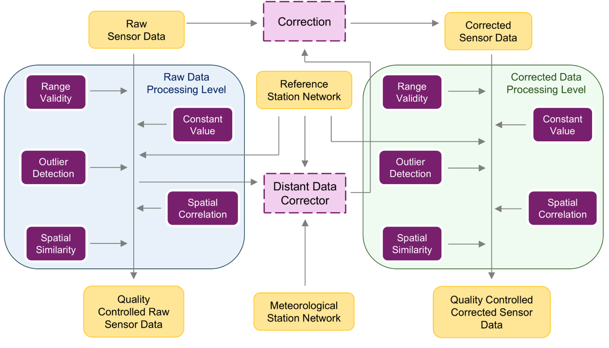
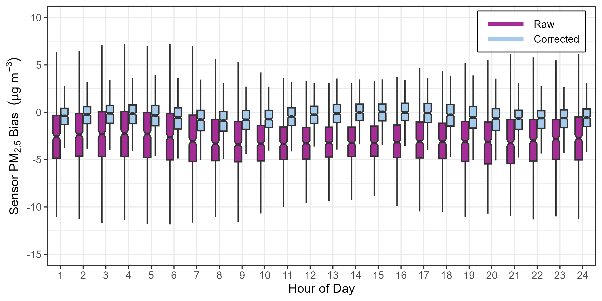
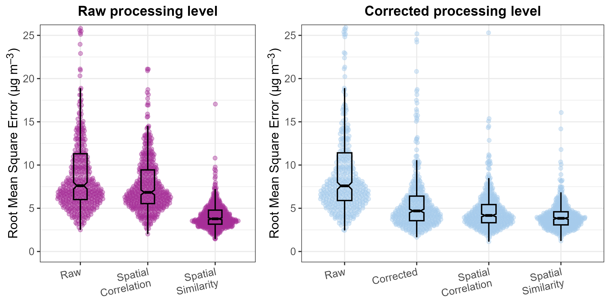

# How to validate sensor data to create Analysis Ready Data?

## Description

Sensor measurements can contain errors and unusual readings. Before analysing the data, it is important to identify potential quality problems and understand whether corrections are appropriate.

The Framework for Improving Low-cost Technology Effectiveness and Reliability (FILTER) provides statistical methods to flag potential erroneous data and correct measurement values. It is designed to work across different sensing devices without requiring each device to be placed alongside a reference monitoring station. However, the version described here requires nearby reference stations or sensors so that measurements can be compared across a network.

FILTER helps prepare data for analysis, but processed data still need to be assessed against the requirements of your monitoring question. Keep the original measurements, quality flags and details of any corrections so that users can understand how the data were prepared.&#x20;

Figure 1 shows the FILTER processing pipeline: 

  

*Figure 1. Overview of FILTER (Framework for Improving Low-cost Technology Effectiveness and Reliability): the two processing levels (<i>Raw</i> and <i>Corrected</i>) and the five quality control (QC) steps applied at each level.*

FILTER was originally developed to quality-control (QC) and correct data from fixed, outdoor low-cost sensors measuring PM2.5.  It comprises two processing levels, <i>Raw</i> and <i>Corrected</i>, each consisting of a five-step QC procedure. Each step assigns a quality flag to every measurement to indicate its reliability. This hierarchical approach allows users to adapt the QC procedure to the availability and characteristics of their data, and to the requirements of specific applications. With appropriate modifications, the processing pipeline can also be extended to other environmental parameters and mobile sensing applications.

The QC steps increase progressively in complexity. The initial steps assess each sensor individually, whereas the later steps and the correction procedure rely on data from neighboring sensors and reference stations. The quality level that a measurement can reach depends on whether a sensor is part of a network and whether reference stations are available nearby.

Each QC step evaluates measurements against statistical criteria using user-defined thresholds. These thresholds determine the trade-off between data quality and data availability: stricter thresholds retain fewer measurements but provide greater confidence in their reliability, whereas more relaxed thresholds preserve a larger proportion of the data, potentially at the expense of confidence in individual measurements. Users can therefore adjust the thresholds to meet the specific requirements of each application.

## Why is this relevant?

Harmonized, quality-controlled, and corrected datasets from various low-cost sensor networks are generally lacking. In order to increase the uptake of data from sensing devices, it is important that the user knows the quality of the data. Lack of data standardization and data of unknown quality limits the use of citizen generated data for official environmental assessments, policy making, and scientific research.&#x20;

FILTER provides a set of statistical algorithms for quality flagging and measurement correction. The tool is available in MATLAB and is also implemented as open-source R packages. These packages provide the full FILTER methodology, together with detailed use cases, supporting its application to both historical and near-real-time datasets.Two variants are available, one for fixed sensors and one for mobile sensors. 

- **FILTER** (fixed sensors):
    - R package: [https://github.com/CitiObs/ValAir-FILTER](https://github.com/CitiObs/ValAir-FILTER)
    - MATLAB code: [https://doi.org/10.6084/m9.figshare.27195720.v1](https://doi.org/10.6084/m9.figshare.27195720.v1)
- **mFILTER** (R package, mobile sensors): [https://github.com/CitiObs/ValAir-mFILTER](https://github.com/CitiObs/ValAir-mFILTER)

## Methodological summary

FILTER’s effectiveness and accuracy were assessed using low-cost sensors and reference stations across Europe. The correction reduced the median bias by 86% overall (Figure 2), with a consistent improvement at every hour of the day.

  

*Figure 2. Diurnal bias of the validated low-cost air quality sensors, before and after applying FILTER.*

Accuracy improved with each QC step, and by the end of the full procedure the typical error decreased by about half at both processing levels (Figure 3).

  2.5 data, before and after applying FILTER." width="800">

*Figure 3. Root Mean Square Error (RMSE) of the validated low-cost sensor PM2.5 data, before and after applying FILTER.*

## Useful resources

Scientific paper describing the methodology: Hassani, A., Salamalikis, V., Schneider, P., Stebel, K., Castell, N. (2025).[ A scalable framework for harmonizing, standardization, and correcting crowd-sourced low-cost sensor PM2.5 data across Europe. Journal of Environmental Management](https://www.sciencedirect.com/science/article/pii/S030147972501076X), 380, 125100.

Validated Dataset for Europe: [https://doi.org/10.6084/m9.figshare.27195720.v1](https://doi.org/10.6084/m9.figshare.27195720.v1) &#x20;

## You might also be interested in

* [What is data quality? How can we increase data quality in citizen gathered data?](../managing-data/what-is-data-quality-how-can-we-increase-data-quality-in-citizen-gathered-data.md)
* [What are the main aspects you need to consider when managing citizen collected data?](../managing-data/what-are-the-main-aspects-you-need-to-consider-when-managing-citizen-collected-data.md)

