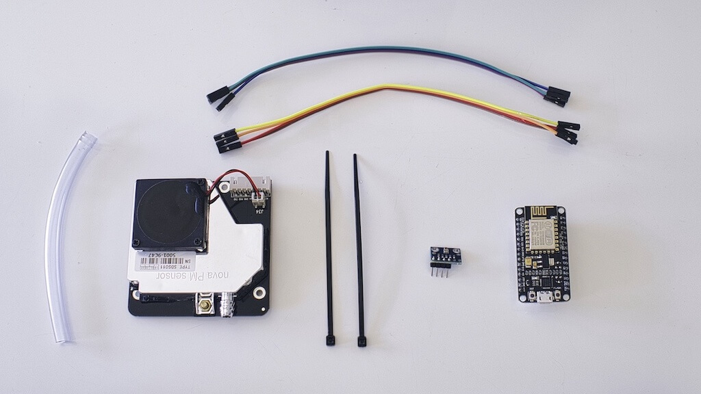
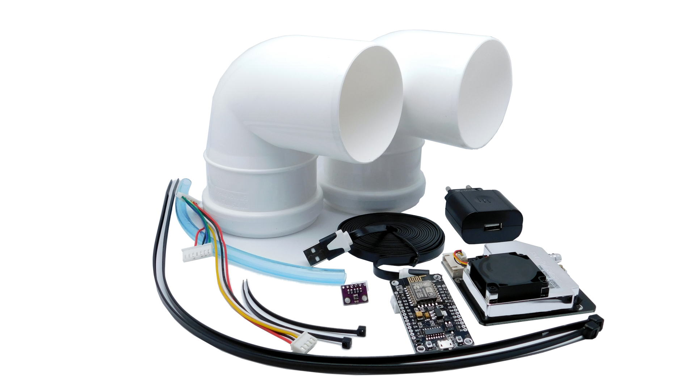

# Sensor.Community

## Description

[Sensor.Community](https://sensor.community/en/) is a large, internationally active citizen science community. It provides easy-to-copy citizen science methods to build a community and to build sensing devices. Their international platform shows measurements of particulate matter, noise and temperature at thousands of locations worldwide.

## When is it useful?

When you want to start doing your own measurements, you are free to make your own choices and pick any sensor or sensing device you like. But making the right choice is not always easy, so why not go with a proven concept? Also, being part of a larger community very likely increases the impact of your measurements.

If you live in the Netherlands or Belgium, your Sensor.Community sensing device gives you another benefit. Your data will automatically be taken up in the [Samen Meten - Dataportaal](https://samenmeten.rivm.nl/dataportaal/) (Netherlands) or the [Dataportaal België](https://samenvoorzuiverelucht.eu/dataportaal-belgie) (Belgium) by the institutes responsible for official air quality monitoring in these countries.

## How to get started

Sensor.Community provides guides in many languages on how to build sensing devices for air quality and noise, and how to connect them to the Sensor.Community data platform: [Find your sensor and building instructions for your DIY fine dust sensor](https://sensor.community/en/sensors/).

## Useful resources

* [Find your sensor and building instructions for your DIY fine dust sensor](https://sensor.community/en/sensors/)
* [Sensor.Community - formerly Luftdaten | Samen Meten](https://www.samenmeten.nl/sensorcommunity) (in Dutch)

## You might also be interested in…

* [Smart Citizen Kit](smart-citizen-kit.md)
* [What are we talking about when we say sensing device?](../what-are-we-talking-about-when-we-say-sensing-device.md)
* [What technical aspects to consider when choosing an air quality sensing device?](../what-technical-aspects-to-consider-when-choosing-an-air-quality-sensing-device.md)
