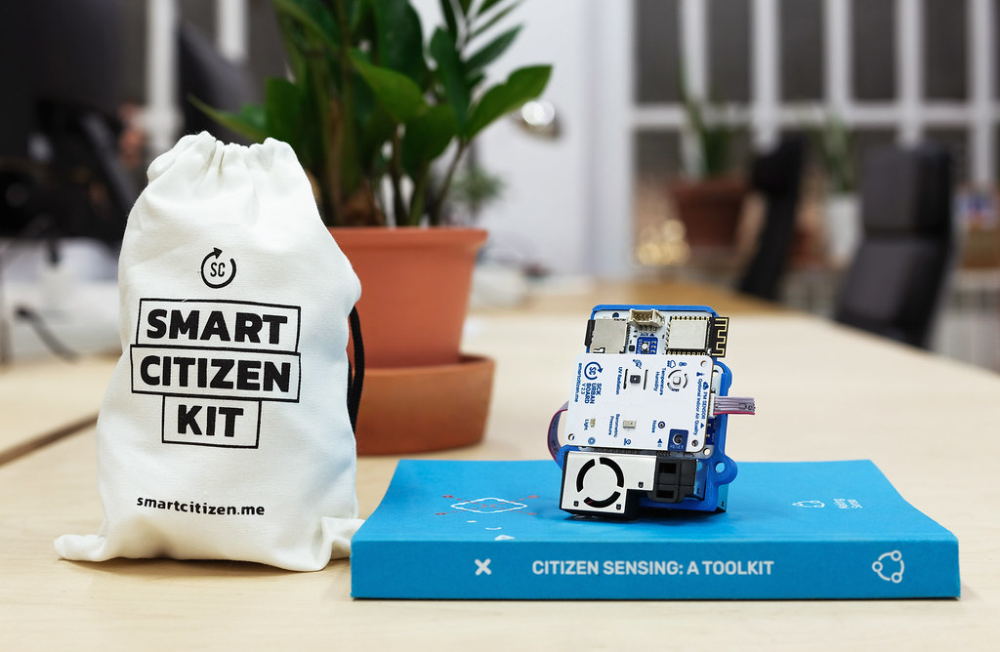

# Smart Citizen Kit

<figure><figcaption>
Smart Citizen Kit 2.3. Photo: <a href="https://www.flickr.com/photos/smartcitizen/54183550083/">Smart Citizen</a>, CC BY-NC-SA 2.0
</figcaption></figure>

## Description

The [Smart Citizen Kit](https://docs.smartcitizen.me/hardware/kit/) (SCK) is an open source environmental monitoring device developed by Fab Lab Barcelona, designed to be used by anyone. The current version (SCK 2.3) measures air temperature, relative humidity, noise level, ambient light, barometric pressure, UV and particulate matter (PM1, PM2.5, PM4 and PM10). Some versions also measure VOC and NOx. The kit sends its data over Wi-Fi to the [Smart Citizen Platform](https://smartcitizen.me/kits), or stores it on a micro SD card when no connection is available.

## When is it useful?

The Smart Citizen Kit is modular: add-ons such as a GPS, a solar panel or a screen can be connected, so the same device can be used for stationary monitoring at a home, school or workplace, or for mobile measurements. Because hardware, firmware and platform are open, you can understand how the data is produced and adapt the device to your needs.

On the Smart Citizen Platform, the data belongs to the people that generate it. Data is public by default and can be explored on a map, downloaded or accessed through an open API. You can also forward the data to other tools, such as the CitiObs data platforms.

## How to get started

Kits can be bought pre-assembled from [Seeed Studio](https://www.seeedstudio.com/Smart-Citizen2-3-p-6327.html) or [LABmaker](https://www.labmaker.org/products/smart-citizen-kit), and some versions are also available as DIY kits. Enclosures can be 3D printed from the designs at [enclosures.smartcitizen.me](https://enclosures.smartcitizen.me).

Once you have a kit, follow the [How to setup a Smart Citizen Kit for air quality monitoring?](../guides/how-to-setup-the-smart-citizen-kit-for-air-quality-monitoring.md) guide to assemble, register and deploy it.

## Useful resources

* [Smart Citizen documentation](https://docs.smartcitizen.me/): hardware, sensors, data and guides
* [Smart Citizen Platform](https://smartcitizen.me/kits): map and data of all public kits
* [Smart Citizen Kit hardware](https://docs.smartcitizen.me/hardware/kit/): sensors and specifications

## You might also be interested in…

* [How to setup a Smart Citizen Kit for air quality monitoring?](../guides/how-to-setup-the-smart-citizen-kit-for-air-quality-monitoring.md)
* [Sensor.Community](sensor-community.md)
* [What technical aspects to consider when choosing an air quality sensing device?](../what-technical-aspects-to-consider-when-choosing-an-air-quality-sensing-device.md)
