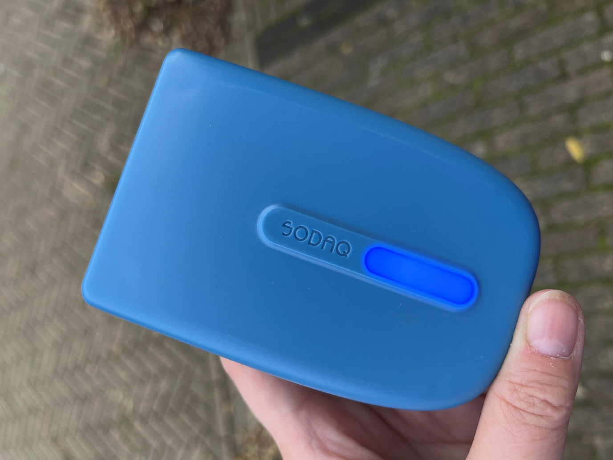

# SODAQ AIR

## Description

The SODAQ AIR, also known as Snifferbike, is a sensing device for particulate matter that can be used either for mobile measurements (on a bike or walking) or stationary. The device tracks your location and sends the data using a SIM card. The measured values are visualised with a colour spectrum light on the device.

## When is it useful?

Performing measurements while moving around gives you an opportunity to investigate your exposure to particulate matter, or to look for local sources such as wood stoves. This sensing device can help you do that, and when you are home again, you can connect it to the electricity and hang it outside so it keeps on measuring. Thus, you can choose how to use it. If you use it stationary, no Wi-Fi or registration to provide your location is necessary.

When used as a mobile sensing device, the SODAQ AIR is very useful for educational purposes.

## How to get started

The company that developed the [SODAQ AIR](https://sodaq.com/portfolio/air/) also produces and sells them, if large enough quantities are ordered. The design is open, so in theory you can build them yourself, though this is not for beginners.

The data are displayed on the [SODAQ AIR](https://www.knowyourair.net/) data platform.

In the Netherlands, the data from the stationary SODAQ AIRs are also displayed on [Samen Meten - Dataportaal](https://samenmeten.rivm.nl/dataportaal/).

## Useful resources

* [SODAQ AIR – SODAQ](https://sodaq.com/portfolio/air/): sensing device description
* [knowyourair.net](https://www.knowyourair.net/): SODAQ AIR data platform
* [Fijnstof - GlobeNL](https://globenederland.nl/onderzoeksprojecten/fijnstof/): Dutch Citizen Science School project using the Snifferbikes

## You might also be interested in…

* [What are the main elements of a sensing device?](../what-are-the-main-elements-of-a-sensing-device.md)
* [What aspects to consider when doing mobile monitoring?](../what-aspects-to-consider-when-doing-mobile-monitoring.md)
* [What technical aspects to consider when choosing an air quality sensing device?](../what-technical-aspects-to-consider-when-choosing-an-air-quality-sensing-device.md)
